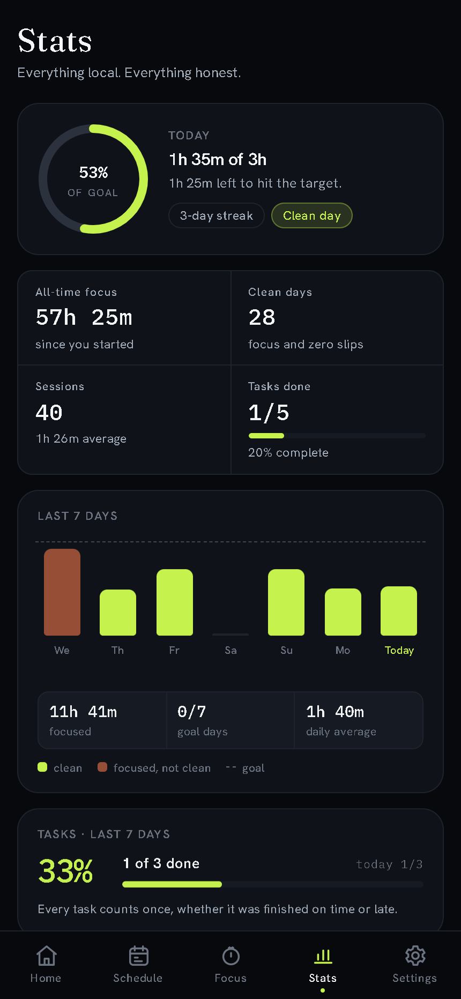

# Lockin — focus, strictly

[](https://github.com/rudra-th/Lockin/actions/workflows/check.yml)
[](https://github.com/rudra-th/Lockin/releases)
[](https://lockin.surge.sh)

**[lockin.surge.sh](https://lockin.surge.sh)**

A study-first focus PWA. Keep a short task list for today and tomorrow, then run wake-locked **Study Mode** sessions that take over the whole screen — and log, honestly, every time you walk away from them.

Vanilla JavaScript. No build step, no framework, no account, no analytics. Everything lives in your browser's localStorage.

## The premise

Regain, Forest, Opal and friends block apps or grow trees. Lockin is doing a different job: **it assumes you want to study, and makes everything else the harder choice.**

| | Lockin's deal |
|---|---|
| Schedule | Recurring blocks, an alarm when one starts, a reminder five minutes before, and today/tomorrow's tasks — no sample data |
| Enforces | Study Mode holds a full-bleed session screen, keeps the screen awake, and **logs a slip** if you leave mid-focus for more than 10 seconds — or quit before your earned-exit bar |
| Forgives | Away under 10s? Forgiven — 3 free accidents a day. End a session after 15 minutes of real work? Neutral — no slip, no broken streak |
| Remembers | Every slip, early quit and rescued accident goes into the Honesty Log. An earned end is recorded as neutral. The streak of *genuinely clean days* is earned, never bought |

One honest limit, stated plainly in-app: **a web app cannot block other apps on your phone** — nothing on the web can. Lockin's enforcement lives inside the session: a full-bleed screen, wake lock, a daily-target meter you can't hide from, and a log that doesn't lie.

## What's inside

- **Schedule** — recurring local-time blocks with a 24-hour day ring, a live “next block” hero, and the day's tasks. Each block has a name, start and end (overnight allowed), days of the week, an on/off switch, an alarm at the start and an adjustable reminder (5 minutes by default, 0–30). The alarm rings in-app, chimes, vibrates and sends a system notification while Lockin is open; the Android build adds exact alarms for when it is closed.
- **Study Mode** — set up on one quiet screen (daily target, Timer or Stopwatch, length with projected end, tasks); preset lengths (10–90 min) or ×3 Pomodoro with configurable focus/short/long breaks; a hold-the-ring intention screen (latches Screen Wake Lock + notification permission in one gesture); the running room keeps the app identity and a live **daily-target meter** (banked today + this session) on screen; attach today's tasks and tick them mid-session; quitting under the earned-exit bar requires a 2.4-second hold + explicit confirm, then it's logged. Once you've banked the bar (15 minutes by default), the control becomes a neutral one-tap **End session** that breaks nothing.
- **Session survives everything** — a running session is snapshotted to storage on every change; close the tab, crash, reload — reopen and the clock is still true (wall-clock math, not setInterval accumulation), and an away-episode that bracketed the reload is processed exactly once.
- **Stats** — today's goal ring and streak, all-time totals, a 7-day bar chart with the daily goal line, task completion, a weekday-aligned 13-week clean-day heatmap, recent sessions and the full Honesty Log. Honest empty states when there is nothing to measure yet.
- **Strict Mode is a switch, not a trap** — off means tracking only: no away slips and no quit slips, ever. **Earned exit** (15 minutes by default, 5–60 or off) makes ending after real work neutral in either mode. Daily goal, clean-day minimum, earned-exit bar and rescue rules: all visible, all adjustable in Settings.
- **First-run film** — seven full-bleed scenes: your name, target exam (JEE, NEET, Boards, MHT-CET and more, or type your own), the rough month and year, a daily study bar, the honest rules, and the permissions the schedule needs — notifications on the web; notifications, exact alarms and usage access on Android. Every ask is optional, shows live status, and links to the system setting if it is denied. No demo session, no seeded schedule. Rerunnable from Settings.
- **Exam countdown on Home** — “182 days left until NEET”, with the approximate month; it turns warm inside 30 days and asks for a new date once the exam passes.
- **Offline-first PWA** — installable, service-worker precache of the entire shell, works with airplane mode on.

## Three surfaces, one repo

| Surface | What it is | Where |
|---|---|---|
| **Web app** | The whole study clock: tasks, Study Mode, earned exit, Stats, Honesty Log. Installable, offline. | `app/` → **[lockin.surge.sh](https://lockin.surge.sh)** |
| **Browser extension** | Only blocking and screen time. No timer, no tasks, no streaks. | `extension/` → pack with `node tools/pack-extension.mjs` |
| **Android app** | The same UI in a Capacitor shell: exact alarms, notification permission, usage access, and per-app screen time. | `android/` → `npm run android:build` |

The web app is the source of truth for a study session. The extension is deliberately the smaller instrument — it holds the block list and counts the active Chrome tab, and says so in its own README.

## Screens

| Home | Schedule |
|---|---|
|  |  |
| **Stats** | **Settings** |
|  |  |

## Docs

| Read this | For |
|---|---|
| [`docs/architecture.md`](docs/architecture.md) | Surfaces, shared core, schedule model, alarm semantics, sync design |
| [`docs/privacy.md`](docs/privacy.md) | What is stored, where, and what sync will mean |
| [`docs/permissions.md`](docs/permissions.md) | Every capability each surface asks for |
| [`docs/android.md`](docs/android.md) | Capacitor build, exact alarms, usage access, blocking tiers |
| [`CONTRIBUTING.md`](CONTRIBUTING.md) | Setup, checks, release process, code rules |
| [`CHANGELOG.md`](CHANGELOG.md) | What shipped, version by version |
| [`SECURITY.md`](SECURITY.md) | Private vulnerability reporting and secret rules |

## Run it

```bash
npm install            # tooling + Capacitor
python serve.py        # → http://localhost:4173, serving app/
npm run check          # JS/JSON/CSS/precache/version sanity
```

Any static file server works; the service worker needs a secure context, and `localhost` counts. To serve the repo root instead (docs, extension source), pass it explicitly: `python serve.py 4173 .`.

For the real test, open it on your phone (same LAN, via `python serve.py <port>` + your machine's IP) and **Install** from the browser menu.

### Extension

```bash
node tools/pack-extension.mjs
```

Open `chrome://extensions`, enable **Developer mode**, **Load unpacked**, pick `dist/extension`. The pack step copies the shared core and the UI fonts into the package; Chrome does not resolve imports outside an extension folder.

## Android

```bash
npm run android:build      # sync app/ + gradlew assembleDebug
npm run android:icons      # regenerate launcher art (Windows, System.Drawing)
```

Requires Android Studio (JDK 21) and SDK platform 36. See
[`docs/android.md`](docs/android.md) for the native bridge, permission tiers and
release signing. The debug APK is not committed; build it locally or download a
release asset.

## Self-check

`tests.html` runs the pure-logic asserts (task storage, session minutes, clean-day streaks, the 10-second accident window, the 20-second free stop, the earned-exit bar, schedule occurrences and alarm events) against your actual browser — also linked from Settings → About. `npm run check` covers the repository-level checks that do not need a browser.

## Structure

```
package.json            scripts: check, pack:extension, android:sync/build
capacitor.config.json   appId com.lockin.app · webDir app/
app/                    the web app — the Capacitor webDir
  index.html            shell + tab bar
  manifest.webmanifest  PWA identity
  sw.js                 offline-first service worker
  favicon.svg           brand glyph source
  assets/
    css/app.css         whole design system (tokens → components)
    js/
      store.js          versioned localStorage store + session math
      exams.js          exam catalogue + rough-date math
      util.js           DOM helpers, re-exporting the pure core
      router.js         hash router
      ui.js             shared sheet, hint and daily-goal meter widgets
      install.js        beforeinstallprompt plumbing
      tasks.js          shared task row / add-form / list controls
      controls.js       shared settings row, toggle and stepper
      alarms.js         schedule alarm engine, chime, overlay, reminder toast
      app.js            bootstrap: theme, routes, live-session resume
      icons.js          inline SVG set
      views/            home · schedule · focus · stats · settings · walkthrough
  core/                 pure, no DOM, no storage — shared by every surface
    time.js             date keys, clock formatting, day math
    honesty.js          accident window, earned exit, free stop
    schedule.js         recurring block math, occurrences, alarm events
  tests.html            pure-logic asserts
extension/              Chrome: blocking + active-tab screen time
  manifest.json         MV3, storage · alarms · tabs · declarativeNetRequest
  background.js         tab tracking, block rules, badge countdown
  popup.html/js/css     today's screen time + the block switch
  blocked.html/js/css   where a blocked site lands
  README.md             build, load, honest limits
android/                Capacitor 8 shell + LockinNative bridge
  app/src/main/         manifest, MainActivity, alarms, usage access
  variables.gradle      SDK 36, minSdk 24, AndroidX versions
tools/
  check.mjs             repo check: parse, JSON, CSS, precache, versions
  pack-extension.mjs    stages dist/extension (copies app/core + fonts)
  gen-icons.ps1         regenerates the PWA icon set (GDI+, no deps)
  gen-extension-icons.ps1
.github/                check workflow, issue forms, PR template
docs/                   architecture, privacy, permissions, Android, releases
serve.py                dev server (defaults to app/, no-store headers)
```

## Data

One localStorage key: `lockin.store.v1`. Export/import a JSON backup from Settings; "Erase all data" is real and re-runs the opening film. Sessions store minutes, tasks and honesty events — no subject list to maintain.

## Status

v1.4.1 — the opening film now asks for the permissions the schedule needs: notifications on the web; notifications, exact alarms and usage access on Android, each with live status and a route to the system setting. v1.4.0 made Plan **Schedule**: recurring local-time blocks with a 24-hour day ring, per-block alarms, a reminder five minutes before (adjustable), and global alarm controls in Settings. The browser extension packs the same block list for Chrome. v1.3.0 made Study Mode subject-free and added the earned exit; v1.2.0 brought tasks, removed demo mode and rebuilt Stats. Live at **[lockin.surge.sh](https://lockin.surge.sh)**.

## License

[MIT](LICENSE) © 2026 Rudra Thorat. Use it, fork it, ship it; keep the notice.
