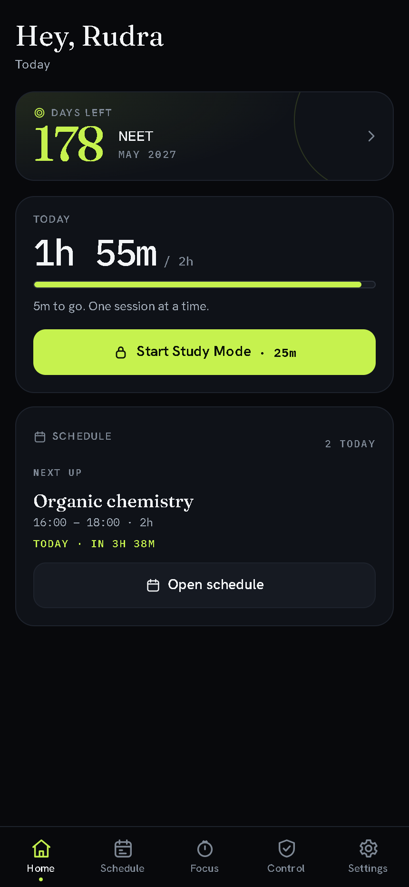
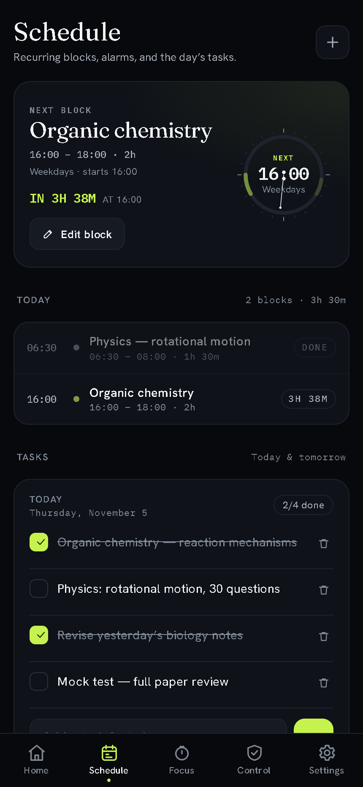
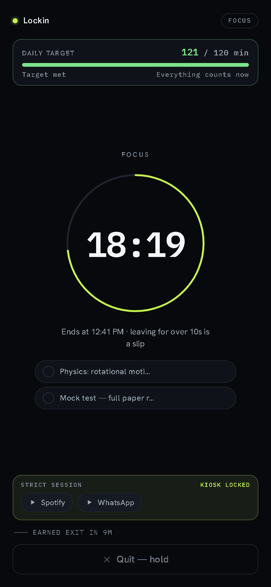
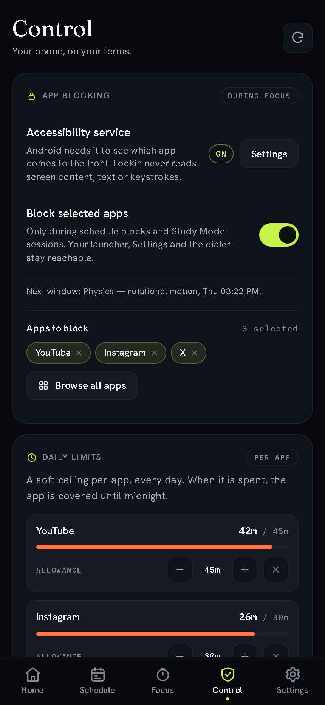
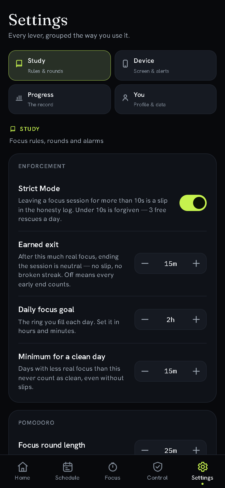
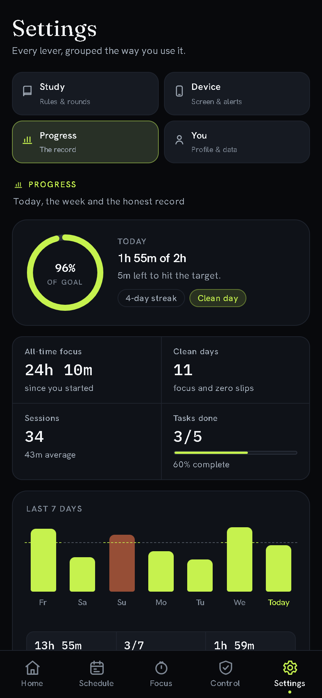

# Lockin — focus, strictly

[](https://github.com/rudra-th/Lockin/actions/workflows/check.yml)
[](https://github.com/rudra-th/Lockin/releases)
[](https://lockin.surge.sh)

**[lockin.surge.sh](https://lockin.surge.sh)**

A study-first focus PWA. Keep a short task list for today and tomorrow, then run wake-locked **Study Mode** sessions that take over the whole screen — and log, honestly, every time you walk away from them.

Vanilla JavaScript. No build step, no framework, no analytics. Everything lives in your browser's localStorage — and an optional Google account can mirror a copy to your own private cloud.

## The premise

Regain, Forest, Opal and friends block apps or grow trees. Lockin is doing a different job: **it assumes you want to study, and makes everything else the harder choice.**

| | Lockin's deal |
|---|---|
| Schedule | Recurring blocks, an alarm when one starts, a reminder five minutes before, and today/tomorrow's tasks — no sample data |
| Enforces | Study Mode holds a full-bleed session screen, keeps the screen awake, and **logs a slip** if you leave mid-focus for more than 10 seconds — or quit before your earned-exit bar |
| Forgives | Away under 10s? Forgiven — 3 free accidents a day. End a session after 15 minutes of real work? Neutral — no slip, no broken streak |
| Remembers | Every slip, early quit and rescued accident goes into the Honesty Log. An earned end is recorded as neutral. The streak of *genuinely clean days* is earned, never bought |

One honest limit, stated plainly in-app: **a web app cannot block other apps on your phone** — nothing on the web can. The Android build can, with an optional accessibility service that sees only which app came to the front: pick the apps, cap their daily minutes, and they are covered during schedule blocks and Study Mode. Turn on the optional device-owner kiosk and strict mode can hold the phone to Lockin and an allowlist — with a deadline that always releases it. It is off until you enable it, fails open when it is off, and never reads screen content. On the web, enforcement lives inside the session: a full-bleed screen, wake lock, a daily-target meter you can't hide from, and a log that doesn't lie.

## What's inside

- **Schedule** — recurring local-time blocks with a 24-hour day ring, a live “next block” hero, and the day's tasks. Each block has a name, start and end (overnight allowed), days of the week, an on/off switch, an alarm at the start and an adjustable reminder (5 minutes by default, 0–30). The alarm rings in-app, chimes, vibrates and sends a system notification while Lockin is open; the Android build adds exact alarms for when it is closed, and a start alarm can take over the lock screen with Dismiss / Open Lockin when Android allows it.
- **Study Mode** — set up around one decision: a big length dial that remembers your last length, with Timer/Stopwatch as a quiet switch; preset lengths (10–90 min) or ×3 Pomodoro with configurable focus/short/long breaks; a hold-the-ring intention screen (latches Screen Wake Lock + notification permission in one gesture); the running room draws a circular progress ring around the clock (a breathing ring for the open-ended stopwatch), keeps the app identity and a live **daily-target meter** (banked today + this session) on screen, and turns attached tasks into a checklist you can tick mid-session; during a strict session, a kiosk dock offers the allowed apps and labels a device-owner-less run **Limited kiosk**; quitting under the earned-exit bar requires a 2.4-second hold + explicit confirm, then it's logged. Once you've banked the bar (15 minutes by default), the control becomes a neutral one-tap **End session** that breaks nothing. A clean finish gets a small confetti burst and a direct route to the week in Settings → Progress.
- **Session survives everything** — a running session is snapshotted to storage on every change; close the tab, crash, reload — reopen and the clock is still true (wall-clock math, not setInterval accumulation), and an away-episode that bracketed the reload is processed exactly once.
- **Settings, in four categories** — **Study** (strict rules, earned exit, goals, Pomodoro, alarms), **Device** (screen wake, notifications, screen time and Android permissions), **Progress** (today's goal ring and streak, all-time totals, a 7-day bar chart with the daily goal line, task completion, a weekday-aligned 13-week clean-day heatmap, recent sessions and the full Honesty Log) and **You** (profile, appearance, account, backup and About). Each category is one tap away with a deep link (`#/settings?section=progress`), and old `#/stats` links land in Progress.
- **Strict Mode is a switch, not a trap** — off means tracking only: no away slips and no quit slips, ever. **Earned exit** (15 minutes by default, 5–60 or off) makes ending after real work neutral in either mode. Daily goal, clean-day minimum, earned-exit bar and rescue rules: all visible, all adjustable in Settings.
- **First-run film** — eight full-bleed scenes: your name (with a Google sign-in shortcut if you already have an account), target exam (JEE, NEET, Boards, MHT-CET and more, or type your own), the rough month and year, a daily study bar, an optional account scene, the honest rules, and every permission the schedule can use — notifications on the web; notifications, exact alarms, full-screen alarms, the accessibility service and usage access on Android. Every ask is optional, shows live status, and links to the system setting if it is denied. Skipping Google is fine; the account scene offers it again before the tour ends. No demo session, no seeded schedule. Rerunnable from Settings.
- **Home in three facts** — days left until your exam (warm inside 30 days, a prompt once it passes), today's focused minutes against your target, and the next schedule block with a live "in 3h 12m". Tasks live in Schedule; streaks, history and screen time live in Settings. Nothing else.
- **Control** — the phone side in one home: a master blocking switch, a searchable app picker, one-tap distraction presets (short videos, feeds, streaming), per-app daily allowances with live usage bars, and the strict kiosk with its allowlist and honestly-labelled pinning fallback. Screen time moved to Settings, where it sits beside the permissions it needs.
- **Browser extension** — blocks a list of sites for 25/45/60 minutes, caps any site at a daily allowance (10 min–2 h), and cuts YouTube Shorts, Instagram Reels, Facebook Reels and Snapchat Spotlight on a toggle that is on by default. Spend a limit and the site holds until local midnight; the blocked page says which rule caught it and when it lifts, and the popup shows today's usage against each allowance. Chrome only, no timer, no account.
- **Android app blocking** — pick apps in Control; a user-enabled accessibility service covers them during schedule blocks and running/paused Study Mode sessions with a full-screen overlay, the block name, a live countdown and one way out: **Leave this app**. Per-app limits use the same foreground signal to count minutes, never page content. The service receives one event type and no screen content, the list stays on the device, and everything fails open when the service is off. A break is free time; Lockin, your launcher, Settings and the dialer are never blocked.
- **Offline-first PWA** — installable, service-worker precache of the entire shell, works with airplane mode on.
- **Optional cloud sync** — sign in with Google on the web (popup) or Android (native sheet) and your tasks, schedules, sessions and slips mirror to your own Firestore tree. Local-first by design: signed out, no Firebase code loads; offline, the store keeps working and sync retries; signing out never touches local data. Last-write-wins for edits, union-by-id for history, tombstones for deletes — and **Delete cloud data** is real.

## Three surfaces, one repo

| Surface | What it is | Where |
|---|---|---|
| **Web app** | The whole study clock: tasks, Study Mode, earned exit, Progress in Settings, Honesty Log, Control's web explanation. Installable, offline. | `app/` → **[lockin.surge.sh](https://lockin.surge.sh)** |
| **Browser extension** | Only blocking, short-video rules, per-site daily limits and screen time. No timer, no tasks, no streaks. | `extension/` → pack with `node tools/pack-extension.mjs` |
| **Android app** | The same UI in a Capacitor shell: exact alarms, full-screen lock-screen alarms, notification permission, usage access, screen time in Settings, app blocking, per-app limits and the strict kiosk in Control, and optional Google sign-in for sync. | `android/` → `npm run android:build` |

The web app is the source of truth for a study session. The extension is deliberately the smaller instrument — it holds the block list and per-site daily allowances, counts the active Chrome tab, and says so in its own README.

## Screens

| Home | Schedule |
|---|---|
|  |  |
| **Study Mode** | **Control** |
|  |  |
| **Settings** | **Progress** |
|  |  |

## Docs

| Read this | For |
|---|---|
| [`docs/architecture.md`](docs/architecture.md) | Surfaces, shared core, schedule model, alarm semantics, sync design |
| [`docs/privacy.md`](docs/privacy.md) | What is stored, where, and what sync will mean |
| [`docs/permissions.md`](docs/permissions.md) | Every capability each surface asks for |
| [`docs/android.md`](docs/android.md) | Capacitor build, exact alarms, usage access, per-app limits, strict kiosk |
| [`CONTRIBUTING.md`](CONTRIBUTING.md) | Setup, checks, release process, code rules |
| [`CHANGELOG.md`](CHANGELOG.md) | What shipped, version by version |
| [`SECURITY.md`](SECURITY.md) | Private vulnerability reporting and secret rules |

## Run it

```bash
npm install            # tooling + Capacitor
python serve.py        # → http://localhost:4173, serving app/
npm run check          # JS/JSON/CSS/precache/version sanity
```

Any static file server works; the service worker needs a secure context, and `localhost` counts. To serve the repo root instead (docs, extension source), pass it explicitly: `python serve.py 4173 .`.

For the real test, open it on your phone (same LAN, via `python serve.py <port>` + your machine's IP) and **Install** from the browser menu.

### Extension

```bash
node tools/pack-extension.mjs
```

Open `chrome://extensions`, enable **Developer mode**, **Load unpacked**, pick `dist/extension`. The pack step copies the shared core and the UI fonts into the package; Chrome does not resolve imports outside an extension folder.

## Android

```bash
npm run android:build      # sync app/ + gradlew assembleDebug
npm run android:icons      # regenerate launcher art (Windows, System.Drawing)
```

Requires Android Studio (JDK 21) and SDK platform 36. See
[`docs/android.md`](docs/android.md) for the native bridge, permissions and
release signing. The debug APK is not committed; build it locally or download a
release asset.

App blocking is opt-in: **Control** opens the system accessibility screen, then
the master switch, the app picker and the distraction presets do the rest. The
service reads foreground package names only, keeps the list and usage counters
in device-local storage, and never reads screen content. Per-app limits count
foreground minutes while it is on. Strict mode can go further with a one-time
device-owner command; without it, Lockin uses screen pinning and says
**Limited kiosk**. It is a focus aid, not a lock — Android lets you turn it off,
and Lockin says so plainly.

## Self-check

`tests.html` runs the pure-logic asserts (task storage, session minutes, clean-day streaks, the 10-second accident window, the 20-second free stop, the earned-exit bar, schedule occurrences and alarm events) against your actual browser — also linked from Settings → About. `npm run check` covers the repository-level checks that do not need a browser.

## Structure

```
package.json            scripts: check, pack:extension, android:sync/build
capacitor.config.json   appId com.lockin.app · webDir app/
app/                    the web app — the Capacitor webDir
  index.html            shell + tab bar
  manifest.webmanifest  PWA identity
  sw.js                 offline-first service worker
  favicon.svg           brand glyph source
  assets/
    css/app.css         whole design system (tokens → components)
    js/
      store.js          versioned localStorage store + session math
      exams.js          exam catalogue + rough-date math
      util.js           DOM helpers, re-exporting the pure core
      router.js         hash router
      ui.js             shared sheet, hint and daily-goal meter widgets
      install.js        beforeinstallprompt plumbing
      tasks.js          shared task row / add-form / list controls
      controls.js       shared settings row, toggle and stepper
      alarms.js         schedule alarm engine, chime, overlay, reminder toast
      firebase.js       lazy Firebase SDK loader (pinned CDN, memoized)
      account.js        Google sign-in, session restore, sign-out
      sync.js           cloud sync engine: pull, merge, push, cursors
      app.js            bootstrap: theme, routes, live-session resume
      icons.js          inline SVG set
      views/            home · schedule · focus · control · stats (Progress) · settings · walkthrough
  core/                 pure, no DOM, no storage — shared by every surface
    time.js             date keys, clock formatting, day math
    honesty.js          accident window, earned exit, free stop
    schedule.js         recurring block math, occurrences, alarm events
    limits.js           daily-allowance math
    shorts.js           short-video URL matcher for the extension
    auth-errors.js      Google sign-in error copy and cancel detection
    sync.js             diff, LWW/append merges, tombstones, cursors
  tests.html            pure-logic asserts
extension/              Chrome: blocking + active-tab screen time
  manifest.json         MV3, storage · alarms · tabs · declarativeNetRequest
  background.js         tab tracking, block rules, badge countdown
  popup.html/js/css     today's screen time + the block switch
  blocked.html/js/css   where a blocked site lands
  README.md             build, load, honest limits
android/                Capacitor 8 shell + LockinNative bridge
  app/src/main/         manifest, MainActivity, alarms, usage access
  variables.gradle      SDK 36, minSdk 24, AndroidX versions
tools/
  check.mjs             repo check: parse, JSON, CSS, precache, versions
  pack-extension.mjs    stages dist/extension (copies app/core + fonts)
  gen-icons.ps1         regenerates the PWA icon set (GDI+, no deps)
  gen-extension-icons.ps1
.github/                check workflow, issue forms, PR template
docs/                   architecture, privacy, permissions, Android, releases
serve.py                dev server (defaults to app/, no-store headers)
```

## Data

One localStorage key: `lockin.store.v1`. Export/import a JSON backup from Settings; "Erase all data" is real and re-runs the opening film. Sessions store minutes, tasks and honesty events — no subject list to maintain.

Signing in adds `lockin.sync.v1` (shadow + pull cursor) and `lockin.sync.on` (the signed-in flag). The cloud copy is a per-entity Firestore tree under `users/{uid}/` — profile and settings as single docs, schedules and tasks with tombstones, sessions and slips append-only.

## Status

v1.11.0 gives the phone side one home: the **Control** tab owns app blocking, distraction presets, per-app daily limits and the optional strict kiosk; screen time and every stat moved into **Settings → Progress**, and Settings is grouped into Study, Device, Progress and You; the opening film gained an optional Google account scene and asks for every Android permission with live status. Google sign-in is fixed for both the web and the native shell, with error copy that names the exact Firebase screen. v1.6.0 added **optional Google sign-in and cloud sync**; v1.5.0 hardened the shell; v1.4.0 made Plan **Schedule** with recurring local-time blocks. Live at **[lockin.surge.sh](https://lockin.surge.sh)**.

## License

[MIT](LICENSE) © 2026 Rudra Thorat. Use it, fork it, ship it; keep the notice.
