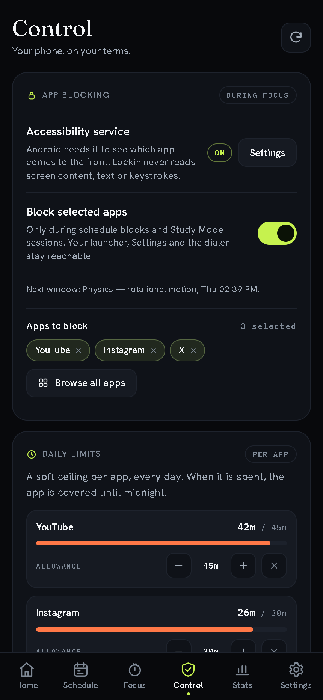
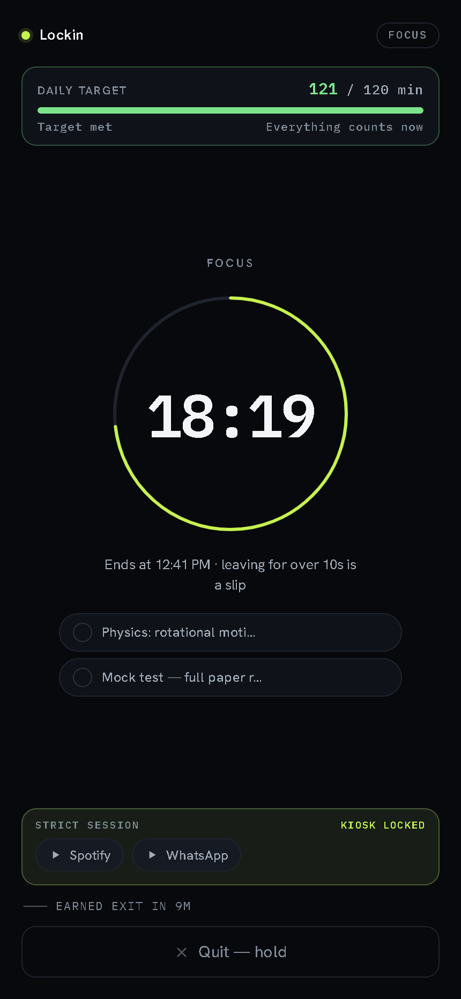
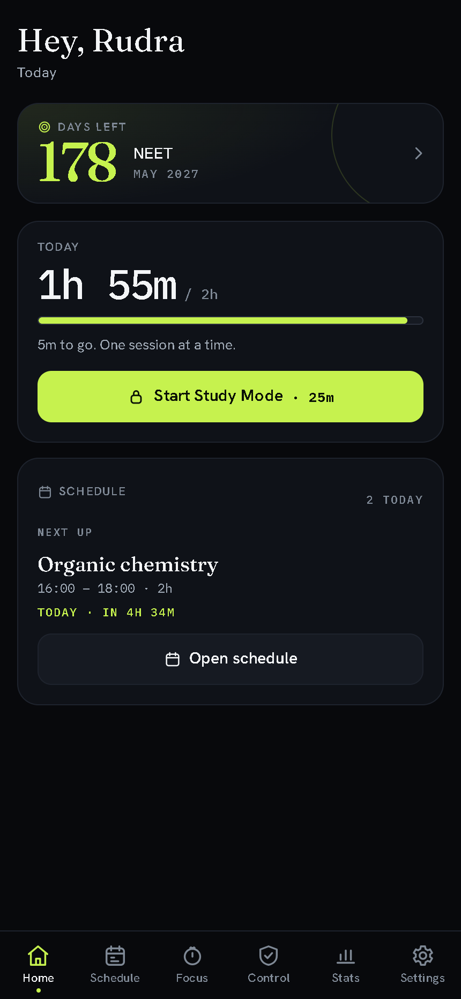
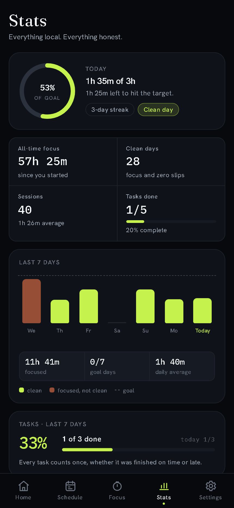

# Lockin v1.11.0 — the phone side

**Released 5 November 2026**

This release turns Lockin from a study clock with a soft nudge into a focus tool
that can actually hold the phone — and still lets go when you say so. A sixth
tab, **Control**, owns everything device-side; screen time moved next to the
permission it needs; and the extension now blocks Shorts, Reels and Spotlight,
not just whole sites.

## What changed

- **Control** — a master blocking switch, a searchable app picker, one-tap
  distraction presets (Short videos / Feeds & chat / Streaming), per-app daily
  allowances with live usage bars, and the strict kiosk, all on one screen.
- **Screen time moved to Settings**, beside usage access. Today's foreground
  time, top apps, a seven-day rail and a refresh action — one place to read it,
  one place to grant the permission.
- **Per-app daily limits** (15 min–3 h) count foreground time in local day
  buckets. Over the line, a **Daily limit reached** overlay names the reset
  time; raising the allowance frees the app immediately.
- **Strict study mode** is a real kiosk with device owner: lock task, an
  allowlist, and a **Back to Lockin** overlay for everything else. Without
  device owner it says **Limited kiosk** and pins the screen instead of
  pretending. A fail-open deadline, enforced in JS and native, means a killed
  app can never leave the phone stuck.
- **The extension blocks short videos** on YouTube, Instagram, Facebook and
  Snapchat with a real path match, and its popup now announces every change,
  names every control, restores focus after a re-render and clears WCAG AA.
- **Google sign-in works on both surfaces**: Credential Manager on Android with
  a legacy-sheet retry, the redirect flow on the web, a real error taxonomy and
  a debug build that now matches the registered release SHA-1.
- **Accessibility**: every settings control takes its name from its row, route
  and scene changes focus the new heading, session phases do the same, progress
  bars expose values, and both themes meet AA contrast.

## Screens

| Control | Study Mode |
|---|---|
|  |  |
| **Home** | **Stats** |
|  |  |

## Install

- **Web**: [lockin.surge.sh](https://lockin.surge.sh) — installable PWA, no
  account required.
- **Extension**: `npm run pack:extension`, then load `dist/extension` via
  `chrome://extensions` → Developer mode → Load unpacked.
- **Android**: `npm run android:build -- assembleRelease`, then sideload
  `android/app/build/outputs/apk/release/app-release.apk`. Device-wide blocking
  needs the accessibility service; the strict kiosk needs device owner. Both are
  opt-in and both fail open.

## Under the hood

- `core/limits.js`, `core/shorts.js` and `core/schedule.js` stay pure and shared
  between the app and the extension; the extension re-uses the same matchers in
  its DNR rules and its in-page check.
- The accessibility service sees only the foreground package name and writes
  day-bucketed minutes to device-local `SharedPreferences` (pruned to two days).
  No screen content, no keystrokes, no network.
- New shared `controls.js` names rows, steppers and segmented groups; the router
  announces routes through one `#a11y-status` live region and focuses the new
  `h1`; Study Mode focuses its phase heading.
- `npm run check`, `npm run lint`, `npm test` (88/88) and `assembleRelease` pass.
  An axe audit of every route in both themes reports zero WCAG A/AA violations,
  and every interactive control on every route has an accessible name.

## Known limits

- Android blocking and the kiosk are verified by build and unit tests here;
  device behaviour still needs a real phone, and the owner runs that pass.
- Per-app limits count only while the accessibility service is on. The card says
  so rather than implying always-on accounting.
- The extension sees the active Chrome tab only — not other browsers, apps or
  the phone.
- Google sign-in needs the release SHA-1 registered in the Firebase project;
  debug builds sign with the release keystore when `android/keystore.properties`
  is complete.
