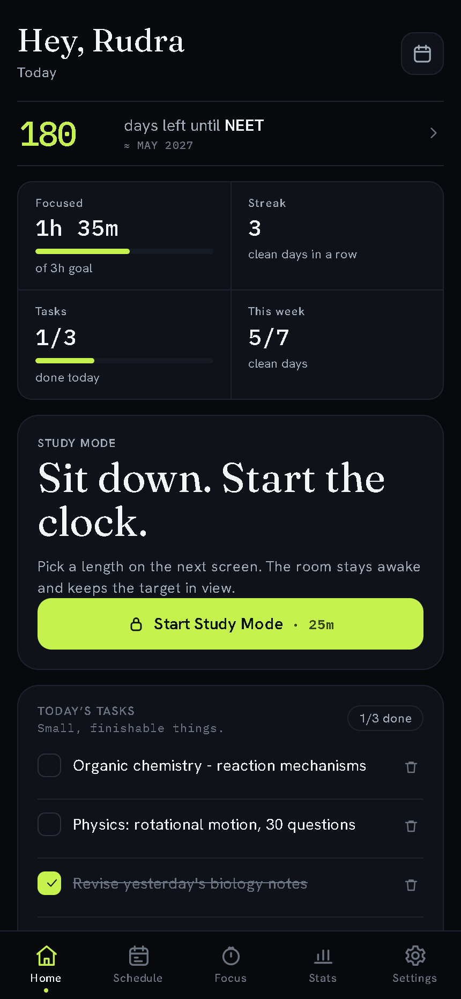
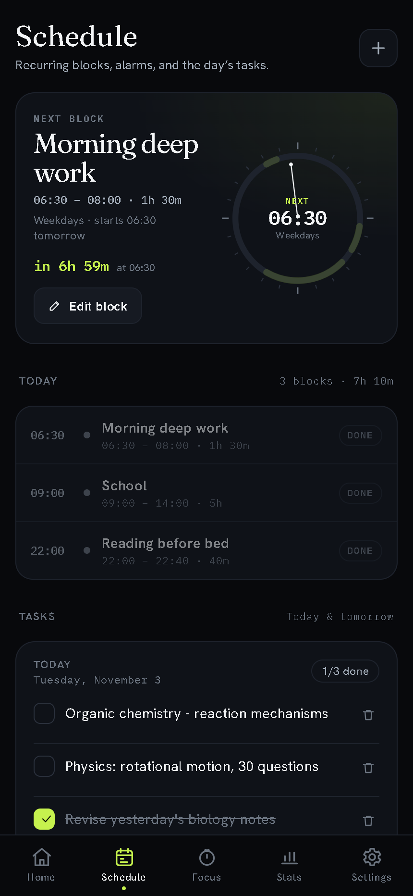
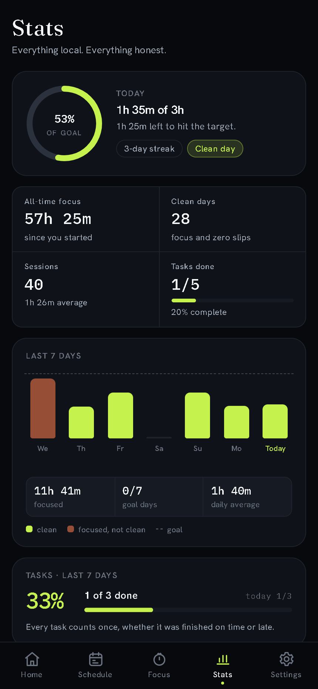
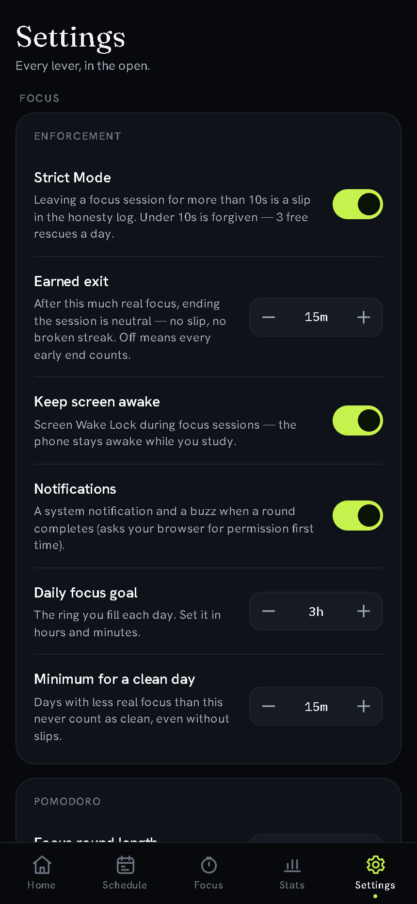

# Lockin v1.4.0 — Schedule

**Released 3 November 2026**

Plan grew up. Lockin now has a real **Schedule**: recurring blocks, a 24-hour day
ring, an alarm when a block starts, and a reminder five minutes before.

## Highlights

- **Recurring blocks** — name, start, end, days of the week, on/off. Overnight
  blocks are supported; `end < start` crosses midnight.
- **A day with a shape** — 24-hour SVG ring, next/ongoing block hero, today's
  blocks, repeating rows with week strips.
- **Alarms that are honest** — a full-screen alarm, a generated chime, vibration
  and a system notification while Lockin is open. The web cannot ring while it
  is closed, and the app says so.
- **A five-minute warning** — adjustable per block (0–30 minutes) and globally.
- **Start from the alarm** — opens Study Mode with the block's length as a
  visible preset. You still start the session yourself.
- **Settings → Schedule** — master alarm switch, default reminder, sound and
  vibration.
- **Plan is now Schedule** — the tab, route, manifest shortcut, Stats links and
  docs all agree. `#/plan` redirects to `#/schedule`.

### Android shell (preview)

- The same UI in a Capacitor 8 shell — not a second app. Exact alarms ring
  when Lockin is closed; a notification tap lands on Schedule.
- **Settings → Android** shows exact-alarm, notification and usage-access
  state, plus a 7-day per-app screen-time panel. Nothing leaves the device.
- Brand launcher icon and splash generated from the same glyph as the PWA.
- The attached APK is **debug-signed** for testing. It is not Play-ready and
  ships no accessibility service or blocking tier. See
  [`docs/android.md`](../android.md).

## Screens

| Home | Schedule |
|---|---|
|  |  |
| **Stats** | **Settings** |
|  |  |

## Under the hood

- New pure core module `app/core/schedule.js`, shared by the web app and the
  extension pack.
- New foreground alarm engine `app/assets/js/alarms.js`.
- New shared controls module `app/assets/js/controls.js`.
- Store migration adds schedules and alarm settings without touching old data.
- Service worker bumped to `lockin.v1.4.0`.
- Self-check: **51/51** asserts, including 9 schedule tests.
- Extension repacked with the shared core: `dist/extension`, 184 KB.

## Install

- **Web**: [lockin.surge.sh](https://lockin.surge.sh) — installable PWA.
- **Extension**: download `lockin-extension-v1.0.0.zip`, unpack it into a
  folder, then load that folder via `chrome://extensions` → Developer mode →
  Load unpacked.
- **Android (preview)**: download `lockin-1.4.0-debug.apk` and sideload it.
  Allow installs from the browser/file manager when Android asks. Exact alarms
  need **Alarms & reminders**; notifications and usage access are requested in
  Settings → Android.

## Known limits

- Web alarms ring only while a Lockin page is alive. Android exact alarms are
  the exception, and only in the APK.
- The extension tracks the active Chrome tab only; it cannot see other browsers
  or apps.
- Sync, Google sign-in and analytics are not in this release.
- Android device-wide blocking is not in this APK; the soft/enhanced tiers stay
  documented until they are built and tested.

## Verification

- `npm run check` — JS parse, JSON, CSS, service-worker precache, versions,
  stale Plan references and extension manifest.
- `app/tests.html` — 51/51 in a real browser.
- Browser smoke test: create/edit/delete a block, reload persistence, alarm
  overlay, reminder toast, Settings toggles, `#/plan` redirect.
- Extension popup and blocked page loaded from `dist/extension`.
- Android: `npx cap sync android` and `gradlew assembleDebug` — BUILD
  SUCCESSFUL, APK produced. Device testing of exact alarms and usage access is
  the next gate; the preview APK is attached for that purpose.
