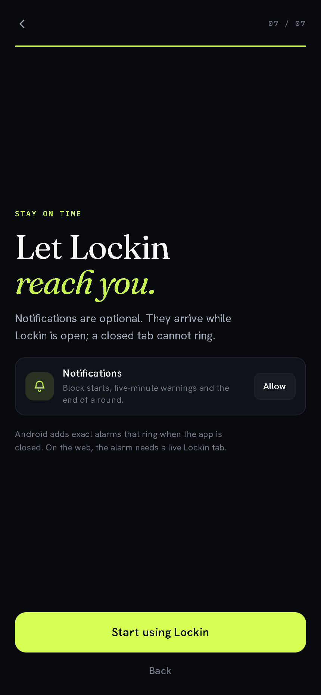
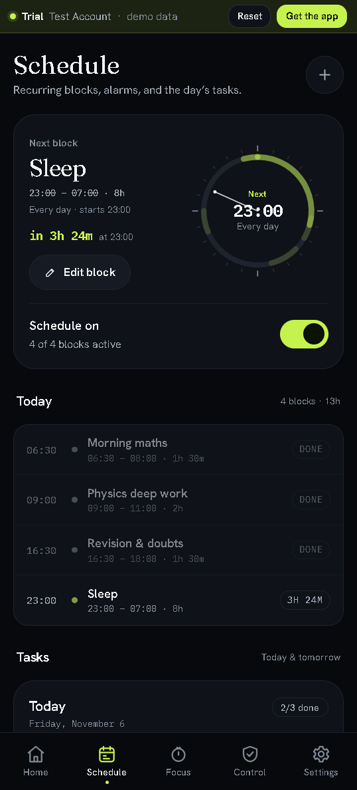

# Lockin v1.4.1 — ask, don't hunt

**Released 4 November 2026**

The opening film now asks for the permissions the schedule needs. Before this,
they were buried in Settings; most people met their first alarm with
notifications switched off.

## What changed

- **A seventh scene: “Let Lockin reach you.”** After the daily bar and the
  honest rules, the film shows the capabilities Lockin can use — and nothing
  is required to finish.
- **Web:** one notification row, requested from a real tap. The copy is
  explicit that web notifications arrive only while a Lockin tab is open.
- **Android:** three rows — notifications, exact alarms, and usage access.
  Each shows a live **On** or **Blocked** state, asks when Android allows it,
  and opens the matching system screen when it does not.
- **Live refresh:** come back from a system setting and the row updates. No
  reload, no guessing.
- **Replay includes it.** Run the film again from Settings → About to fix a
  denied permission without hunting through menus.
- **Still honest:** the clock works with every permission denied. The final
  button is always **Start using Lockin**.

## Screens

| New: permissions | Schedule |
|---|---|
|  |  |

## Install

- **Web**: [lockin.surge.sh](https://lockin.surge.sh) — installable PWA.
- **Extension**: unchanged from v1.4.0. Download `lockin-extension-v1.0.0.zip`,
  unpack it into a folder, then load that folder via `chrome://extensions` →
  Developer mode → Load unpacked.
- **Android (preview)**: download `lockin-1.4.1-debug.apk` and sideload it.
  The APK is debug-signed, not Play-ready, and still ships no blocking tier.
  Exact alarms need **Alarms & reminders**; notifications and usage access are
  requested in the opening film or Settings → Android.

## Under the hood

- `app/assets/js/views/walkthrough.js`: a `permissions` scene with a small
  state machine for web and native, a visibility listener that cleans itself
  up, and no dependency on a grant.
- New `grid` icon; permission rows reuse the existing `film-*` design language.
- Service worker bumped to `lockin.v1.4.1`; Android `versionCode` 141,
  `versionName` 1.4.1.
- `npm run check` passes; the web flow, granted state, replay and a stubbed
  native bridge were exercised in Chrome. Device testing of the Android
  settings hand-off is still the next gate.

## Known limits

- Web alarms ring only while a Lockin page is alive. Android exact alarms are
  the exception, and only in the APK.
- The extension tracks the active Chrome tab only; it cannot see other browsers
  or apps.
- Sync, Google sign-in and analytics are not in this release.
- Android device-wide blocking is not in this APK; the soft/enhanced tiers stay
  documented until they are built and tested.
